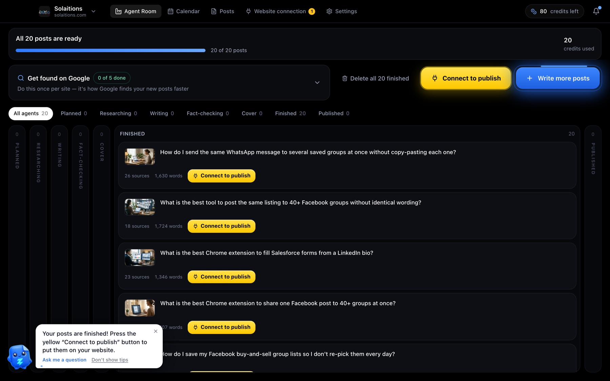
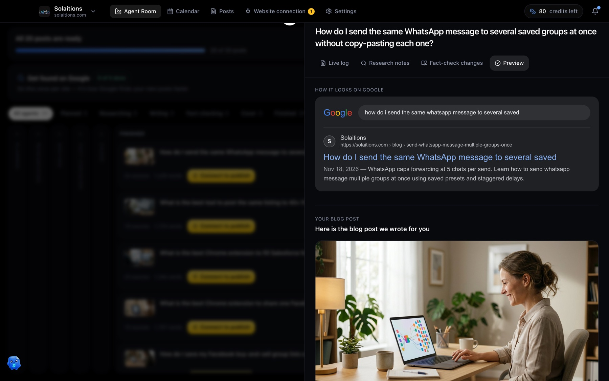
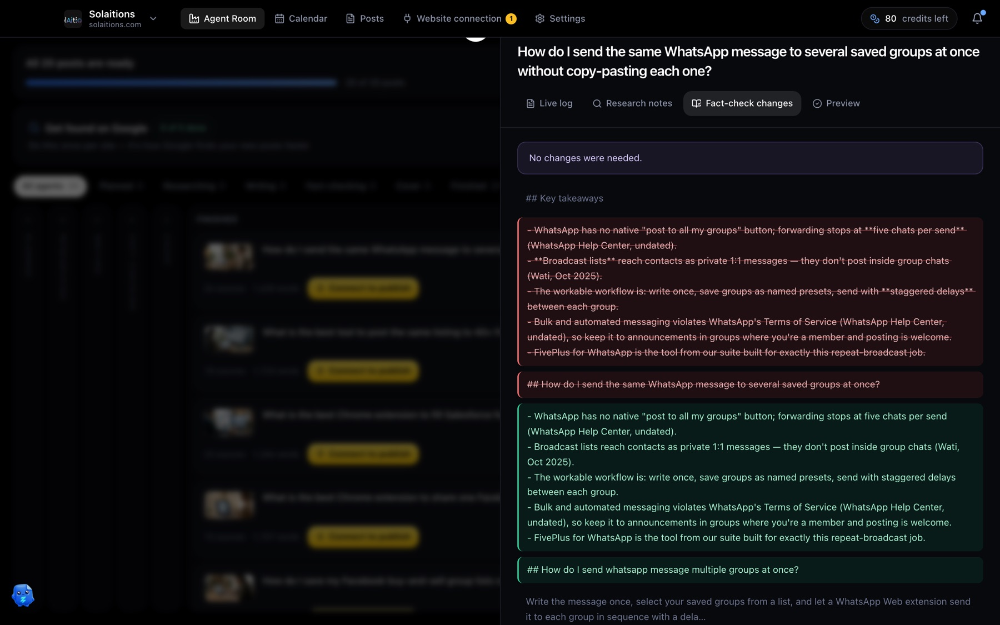
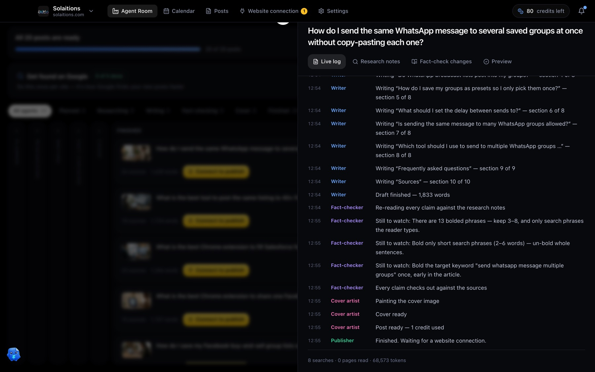

<h1 align="center">Zippy Blog</h1>

<b>A blog that brings you customers, written while you watch.</b> 
Type your web address. AI agents research what your buyers search for on Google, write the posts, check every fact, paint a cover for each one and publish them to your website.

  <a href="https://project-vyxv2.vercel.app/api/download?os=mac"><b>⬇️ Download free for Mac</b></a> &nbsp;·&nbsp;
  <a href="https://project-vyxv2.vercel.app/api/download?os=windows"><b>⬇️ Download free for Windows</b></a> &nbsp;·&nbsp;
  <a href="https://inventabotnow.github.io/zippyblog-download/">Website</a>

<b>🎁 20 blog posts free — no credit card.</b>

## Your AI blog team — five specialists on every post

| 🔎 Researcher | ✍️ Writer | 🛡️ Fact-checker | 🎨 Cover artist | 🚀 Publisher |
|---|---|---|---|---|
| Searches the web and reads real, dated sources | Writes the answer your buyer is searching for | A separate agent re-checks every claim | Paints an original cover for every post | Puts each post on your site on its date |

### See exactly how it will look on Google

### A second AI checks every claim

### Watch every step, live

### Every post gets its own cover

  
  

## Install

- **Mac** (Apple Silicon and Intel): download the `.dmg`, open it and drag **Zippy Blog** to Applications. Signed and notarized by Apple.
- **Windows**: download the `.exe` and double-click it. If SmartScreen warns, click **More info**, then **Run anyway**.

Already using Zippy Blog? It updates itself every time you open it. All versions: [Releases](https://github.com/inventabotnow/zippyblog-download/releases/latest).
